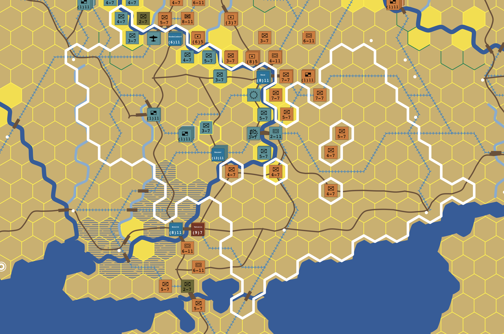

# Hexagones: A-B-C coordinate boundary extraction

**Philippe Mullhaupt**  
Laboratoire d'Automatique, EPFL

This repository accompanies the research paper **An A-B-C Coordinate Construction for Exact Boundary-Cycle Extraction on Hexagonal Lattices**, published as a preprint on arXiv.

**Read the paper on arXiv:** [arXiv:2610.25451 — official abstract and download page](https://arxiv.org/abs/2610.25451)  
**Direct PDF:** [arxiv.org/pdf/2610.25451](https://arxiv.org/pdf/2610.25451)

The manuscript itself is hosted on arXiv, not in this repository.

The work describes an integer-coordinate, role-qualified point/tail representation of hexagonal cell boundaries, exact edge cancellation, and extraction of boundary cycles, including holes. It compares the encoding against a cube-coordinate vertex-triple/half-edge hashing baseline.

## Hexagones 2.0 — original application

*Hexagones 2.0 — an example game map showing terrain, transport networks, boundaries, and military counters.*

The Hexagones game provides the practical context for the boundary-extraction work. The complete game is not distributed in this repository.

## Scientific scope

Three-axis coordinates, boundary operators, and cycle extraction are established concepts. The manuscript focuses on the explicit A-B-C point/tail incidence encoding. No historical-priority claim is made. The arXiv preprint is publicly available; arXiv posting does not constitute journal peer review.

## Game design acknowledgments

The game design of **Hexagones 2.0** draws inspiration from the original **PanzerKrieg** board game published by **Avalon Hill**. This acknowledgment recognizes the historical game-design inspiration; Hexagones 2.0 is not presented as an official Avalon Hill product or an endorsement by its rights holders.

Special thanks to **Dr. Gianluca Vecchietti** for directing the game-design work and for the many games played together, whose experience and discussions helped shape the project.

## Attribution and code status

The author is Philippe Mullhaupt. ChatGPT (OpenAI) assisted with code inspection, refactoring-related analysis, mathematical exposition, verification scripts, and LaTeX/TikZ preparation. Earlier development and verification materials are not all included in the current repository.

## Copyright and licensing

Copyright (c) 2026 Philippe Mullhaupt. The work is personally authored; **Laboratoire d'Automatique, EPFL** is the author's professional affiliation only and does not imply EPFL ownership or endorsement.

The repository includes `LICENSE-CODE` for code licensing. The paper is available from arXiv rather than distributed here; consult the arXiv record for its license and reuse terms. Repository licensing does not grant rights over third-party dependencies or the unreleased game project.
